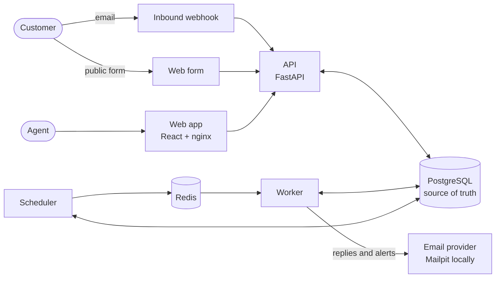

# ResolveFlow

**Customer support and SLA automation for small service teams.**

One shared inbox. Response-time targets that respect business hours. Automation rules you can test before they go live. Nothing in the interface is a mock.

## Why it exists

Small agencies and service businesses answer customers from a shared mailbox, and three things go wrong: nobody is sure who owns a message, response-time promises are tracked by memory, and clever routing rules are scary to change because you cannot tell what they will do. ResolveFlow fixes those three problems and deliberately stops there. It is not a helpdesk suite.

## Highlights

| | |
| --- | --- |
| **A real shared inbox** | Email in and out, a public web form, manual tickets. Threading, duplicate detection, merge, bulk actions and keyboard shortcuts. |
| **Deadlines you can explain** | First-response and resolution targets per priority, counted in business hours and timezones, paused while you wait on the customer. Every deadline shows exactly how it was calculated. |
| **Automations you can trust** | Conditions and actions in plain language. A rule goes live only after a passing test of that exact version, and any edit needs a new test. Each ticket shows which rules ran and why. |
| **Reliable by design** | A scheduler records warnings and breaches exactly once, survives restarts, and never double-sends. PostgreSQL is the source of truth for every job. |
| **Strictly separated workspaces** | Tenant isolation is enforced by the database itself (row-level security), not just by application code. |
| **Useful alerts** | In-app and email notifications with per-person preferences, no duplicates, automatic retries and an admin view for failures. |
| **Findable history** | Full-text search with highlighted matches and a history page for every customer. |
| **Honest numbers** | SLA compliance, response and resolution times, and volume by day, priority, channel and teammate. |
| **Privacy controls** | Configurable retention that erases old finished tickets and customer details. |

## Run it in one click

You need [Docker Desktop](https://www.docker.com/products/docker-desktop). Then:

- **Windows:** double-click `start.bat`.
- **macOS, Linux, WSL:** `./start.sh` (or `make up`).

It builds and starts everything, waits until the API is healthy and opens the app. The first start takes a few minutes; later starts take seconds.

| What | Where |
| --- | --- |
| The app | http://localhost:3000 |
| Captured outgoing email (Mailpit) | http://localhost:8025 |
| Public contact form for the demo workspace | http://localhost:3000/form/brightwork |
| API documentation | http://localhost:8000/docs |

**Demo accounts** (password `resolveflow-demo`): `owner@brightwork.test`, `admin@brightwork.test`, `agent@brightwork.test`, `viewer@brightwork.test`. The demo workspace, "Brightwork Studio", has about 60 synthetic tickets, a team, three live automations and realistic service-level history. No real customer data is involved.

`stop.bat` stops the stack and keeps your data. `reset.bat` stops it and **deletes all data**. Ports and settings live in `.env`, created from `.env.example` on first run. Everything binds to `127.0.0.1` only.

New here? Follow the [10-minute demo walkthrough](docs/DEMO.md).

## A tour

<table>
<tr>
<td width="50%"> <b>Automations</b>: build a rule, test it on a made-up ticket, see exactly why it matched.</td>
<td width="50%"> <b>Service levels</b>: targets per priority, business hours, timezone and holidays.</td>
</tr>
<tr>
<td width="50%"> <b>Analytics</b>: SLA compliance, response times and volume.</td>
<td width="50%"> <b>Search</b>: find tickets by anything a customer wrote.</td>
</tr>
<tr>
<td width="50%"> <b>Notifications</b>: choose what reaches you, in the app or by email.</td>
<td width="50%"> <b>Dark theme</b>, remembered per browser.</td>
</tr>
</table>

## How it works

- **A modular monolith.** One Python codebase, started three ways: API, worker, scheduler. Seven containers in total: `db`, `redis`, `mailpit`, `api`, `worker`, `beat`, `web`.
- **PostgreSQL decides.** Redis only wakes workers up. Email delivery, SLA checks and notification mail are rows with a state, so a restart, a lost message or a duplicate task cannot lose or repeat work.
- **Pure engines.** The SLA maths and the rule evaluator are plain functions with no database access, so they are tested directly and exhaustively.
- **Everything is audited**, naming the actor: a person, the system, or a rule.

Read more in [docs/ARCHITECTURE.md](docs/ARCHITECTURE.md).

## Built with

| Area | Technology |
| --- | --- |
| Backend | Python 3.12, FastAPI, SQLAlchemy (SQL via `text()`), Alembic, Pydantic v2, Argon2 |
| Jobs | Celery with Redis (worker and beat), database-driven retries |
| Data | PostgreSQL 16 with row-level security and full-text search |
| Frontend | React 19, TypeScript, Vite, Tailwind CSS v4, TanStack Query, React Router |
| Email | Provider interfaces for SMTP (Mailpit) and Postmark |
| Quality | pytest + testcontainers, Vitest + Testing Library, Playwright, ruff, mypy, oxlint, GitHub Actions |
| Packaging | Docker Compose, one-click scripts |

## Quality

- **336** backend tests (including real PostgreSQL and Redis), **104** frontend tests and **35** end-to-end browser tests, run on every change in CI.
- Static checks: ruff, mypy, oxlint and the TypeScript compiler.
- Each phase was reviewed by an independent reviewer before merging; the findings and fixes are in the git history.
- Restart safety, tenant isolation and idempotency are tested explicitly, not assumed.

## Documentation

| | |
| --- | --- |
| [Demo walkthrough](docs/DEMO.md) | A guided 10-minute tour |
| [User guide](docs/USER_GUIDE.md) | Every feature, with roles and permissions |
| [Architecture](docs/ARCHITECTURE.md) | How it is built and why |
| [Development guide](docs/DEVELOPMENT.md) | Set up, change and test the code |
| [API reference](docs/API.md) | Every endpoint |
| [Security and privacy](docs/SECURITY.md) | What is enforced and the known limits |
| [Troubleshooting](docs/TROUBLESHOOTING.md) | Common problems and fixes |
| [Product requirements](docs/PRD.md) and [design](docs/superpowers/specs/2026-10-30-resolveflow-design.md) | What was decided and why |
| [Changelog](CHANGELOG.md) | The five phases |

## Using real email

Outgoing mail goes to Mailpit by default and never leaves your machine. To send through [Postmark](https://postmarkapp.com), put `EMAIL_PROVIDER=postmark` and `POSTMARK_SERVER_TOKEN=...` in your local `.env` (it is git-ignored; never commit a token). Inbound mail arrives at `/api/webhooks/email/postmark` (basic auth with `POSTMARK_WEBHOOK_SECRET`). Locally you simulate inbound mail from the **Channels** page, which runs the same code. Details and caveats are in [Troubleshooting](docs/TROUBLESHOOTING.md#email).

## Scope and limits

ResolveFlow is intentionally small: email and web-form channels only, no customer portal, no auto-replies to customers, a fixed set of rule fields (no regular expressions or custom fields), password sign-in only, and polling-based notifications. The full list of non-goals is in the [PRD](docs/PRD.md), and known security limits are in [docs/SECURITY.md](docs/SECURITY.md).

## Contributing

See [CONTRIBUTING.md](CONTRIBUTING.md) and the [development guide](docs/DEVELOPMENT.md).
