# User guide

This guide explains ResolveFlow from the point of view of the people who use it. For a quick tour, follow the [demo walkthrough](DEMO.md).

## Contents

1. [Roles and permissions](#roles-and-permissions)
2. [The inbox](#the-inbox)
3. [Working a ticket](#working-a-ticket)
4. [Service levels](#service-levels)
5. [Automations](#automations)
6. [Teams](#teams)
7. [Notifications](#notifications)
8. [Search and customer history](#search-and-customer-history)
9. [Analytics](#analytics)
10. [Channels: email and the web form](#channels-email-and-the-web-form)
11. [People and the audit log](#people-and-the-audit-log)
12. [Privacy and data retention](#privacy-and-data-retention)
13. [Keyboard shortcuts](#keyboard-shortcuts)

## Roles and permissions

Every person belongs to a workspace with one role.

| Capability | Owner | Admin | Agent | Viewer |
| --- | :---: | :---: | :---: | :---: |
| Read tickets, search, see customer history | yes | yes | yes | yes |
| Create tickets, reply, add notes, change status, priority, tags | yes | yes | yes | no |
| Assign, merge, bulk-edit tickets | yes | yes | yes | no |
| See and edit automations and teams | yes | yes | no | no |
| Change service levels, channels, privacy | yes | yes | no | no |
| Invite people, change roles, read the audit log | yes | yes | no | no |
| Analytics, failed-email list | yes | yes | no | no |

The last owner of a workspace cannot be removed or demoted. Pages you cannot use are hidden from the sidebar.

## The inbox

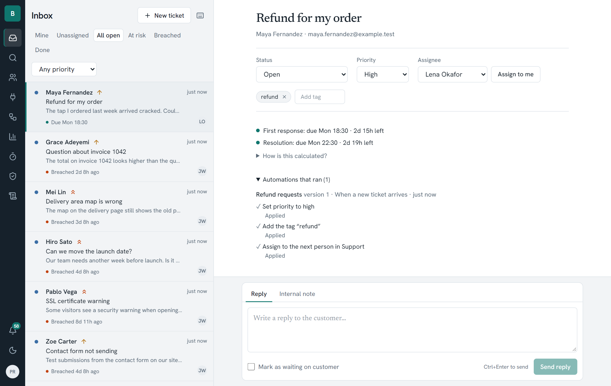

The left column is the queue. The tabs filter it:

- **Mine** and **Unassigned** show tickets by owner.
- **All open** is everything not resolved or closed.
- **At risk** and **Breached** show tickets close to, or past, a service deadline.
- **Done** shows resolved and closed tickets.

Each row shows the customer, priority, a snippet, the next deadline and the assignee. Select several rows with the checkboxes to change status, priority or assignee in one step.

## Working a ticket

The right column shows the conversation, newest at the bottom, with the properties above it:

- **Status**: new, open, pending (waiting on the customer), resolved, closed. Replying to a new ticket moves it to open.
- **Priority**: low, normal, high, urgent. It decides which service-level targets apply.
- **Assignee**: any active teammate. **Assign to me** is one click.
- **Tags**: free labels you can search and filter by.

Use **Reply** to write to the customer (it is emailed) or **Internal note** for teammates only. Tick **Mark as waiting on customer** to pause the clock while you wait for them.

**Merge** combines a duplicate ticket into another; the messages move to the surviving ticket. A banner offers to review a *possible duplicate* when a customer writes twice in quick succession.

## Service levels

Every ticket carries two clocks: **first response** and **resolution**. The targets depend on priority and are counted in business hours in your workspace timezone.

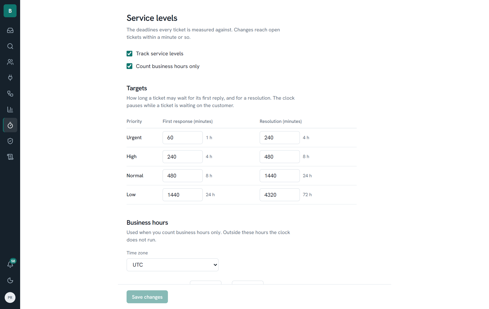

- Open **Service levels** in the sidebar to set the target for each priority, switch business-hours-only counting on or off, set the working week and timezone, and add holidays.
- Changing a target updates the deadline of every open ticket.
- On a ticket, **How is this calculated?** lists each moment the clock started, paused, resumed or stopped, so nobody has to guess why a deadline is what it is.
- The clock pauses while a ticket is *pending* and resumes when the customer replies or you reopen it.
- A scheduler records a **warning** at 75% of the target and a **breach** at 100%, once each, even across restarts.

## Automations

Automations do routine work for you, and you can prove they work before they go live.

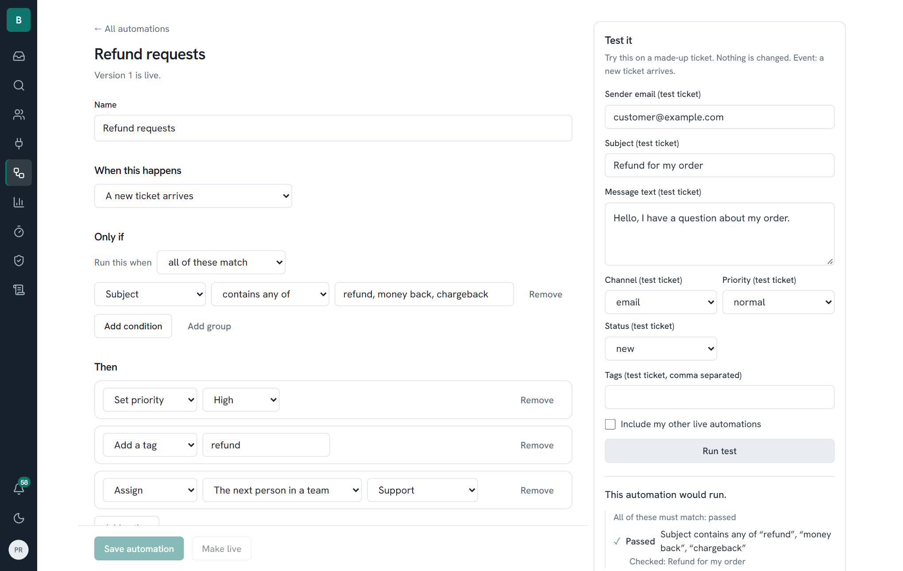

An automation has three parts:

1. **When this happens:** a ticket arrives, a message is received, a status changes, or a service deadline reaches a warning or breach.
2. **Only if:** conditions over a fixed set of fields (sender, subject, message text, channel, priority, status, tags, assignee). Combine them with *all of these* or *any of these*, and nest groups.
3. **Then:** assign (to a person or the next person in a team), set priority, set status, add a tag, notify, or escalate.

### The safe workflow

- **Save** creates a new *version*. Versions are immutable.
- **Test it** runs the draft against a made-up ticket. Nothing real changes. You see which conditions passed and what each action would do.
- **Record as test** stores a passing test tied to the exact content of that version.
- **Make live** is enabled only when the current version has a passing test. Edit the rule and it is locked again until the new version is tested. The previous live version keeps running meanwhile, and you can roll back to any older tested version.

### Order and conflicts

Rules run in the order shown on the list (use the arrows to reorder). If two rules try to set the same thing, the first wins and the other is recorded as skipped. Rules can trigger further rules, up to three levels deep, and each rule fires at most once per ticket per chain.

### Why did this happen?

Open any ticket and expand **Automations that ran**. It lists each rule, the version that ran, and whether each action was applied, skipped (with the reason) or failed (for example, the person it assigns to has been deactivated). A failing rule never blocks the change that triggered it.

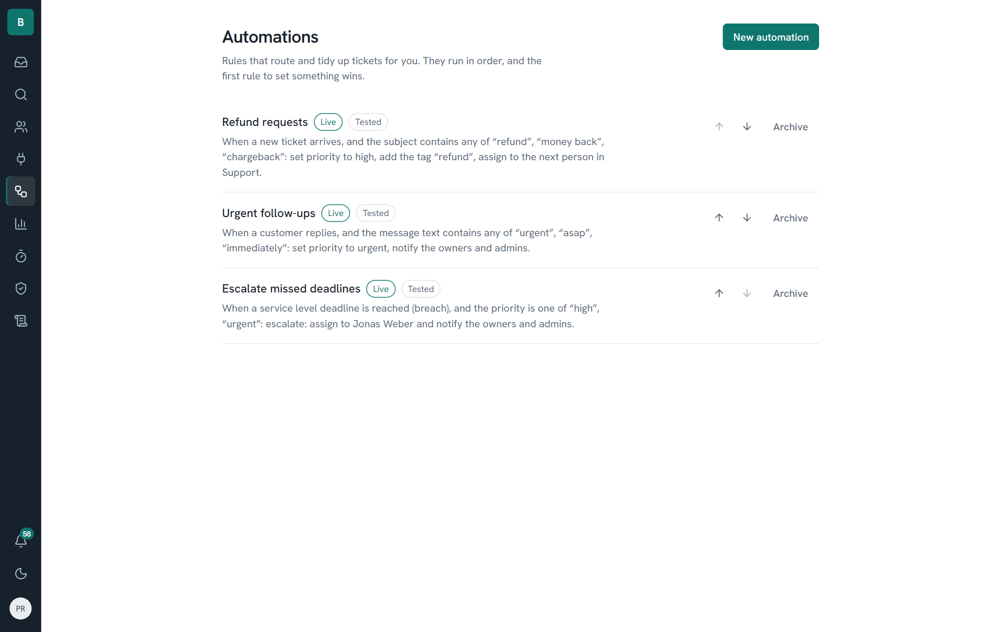

## Teams

Under **People**, create teams and choose their members. A team can be the target of a round-robin assignment or a notification. A team that a live rule uses cannot be deleted.

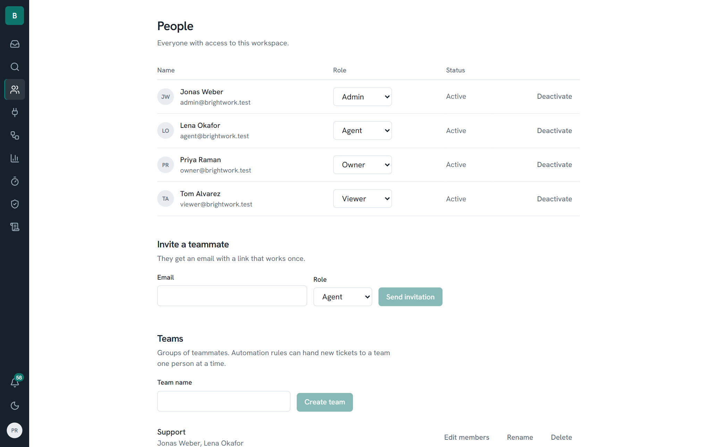

## Notifications

The bell in the sidebar shows how many unread notifications you have and updates about every 20 seconds.

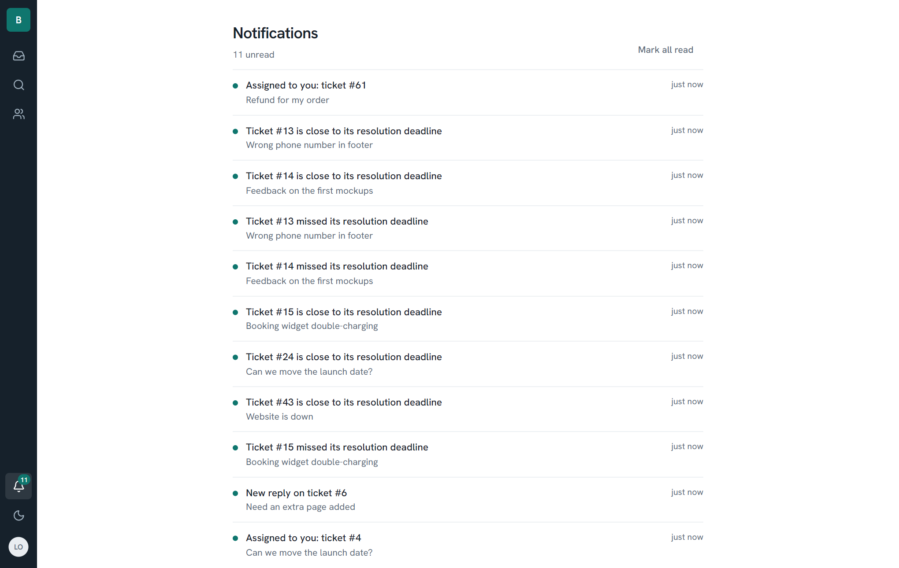

You are notified when:

- a ticket is **assigned to you**,
- a **customer replies** on your ticket,
- a ticket's **service deadline** is near or missed (assigned to you, or unassigned if you are an owner or admin),
- an automation **escalates** a ticket or **notifies** you.

Choose, per kind, whether it appears **in the app**, **by email**, both or neither. By default, service-deadline and escalation alerts are also emailed. The same event never notifies you twice.

Owners and admins also see **Emails that could not be sent**: a notification email that failed five times stops retrying, and **Send again** queues it once the problem is fixed.

## Search and customer history

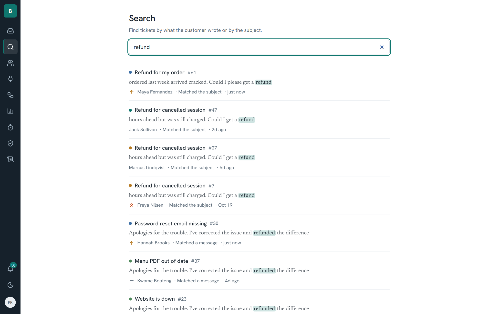

**Search** looks through subjects and every message, ranks matches, and highlights them. Quotes match an exact phrase, and `-word` excludes a word. Click a customer's name or email at the top of a ticket to see everything they have ever written.

## Analytics

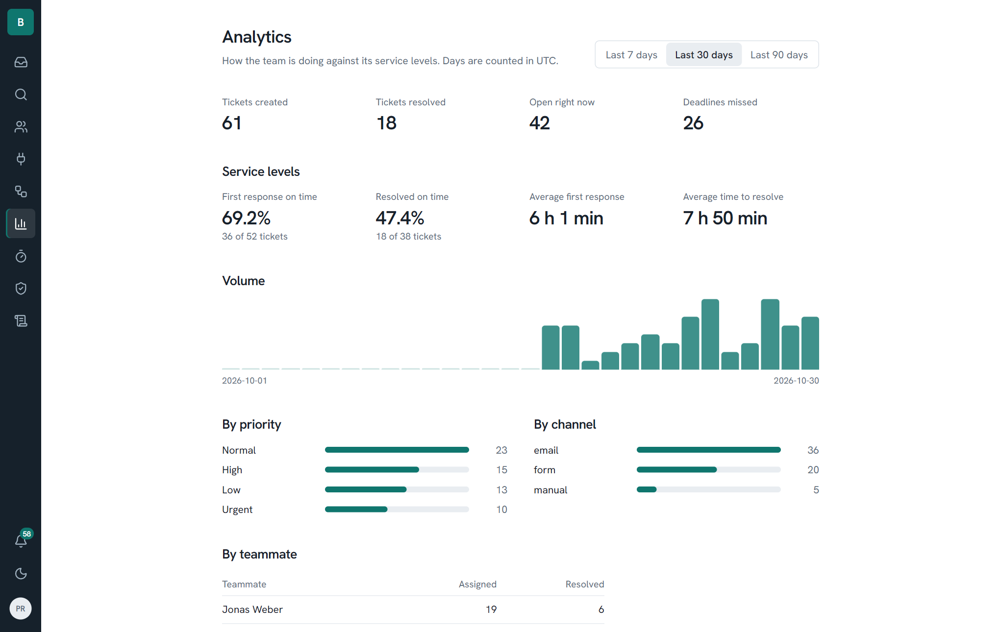

Owners and admins can see, for the last 7, 30 or 90 days: tickets created, resolved and open; how often first response and resolution were on time; average first-response and resolution time; and volume by day, priority, channel and teammate. Days are counted in UTC.

## Channels: email and the web form

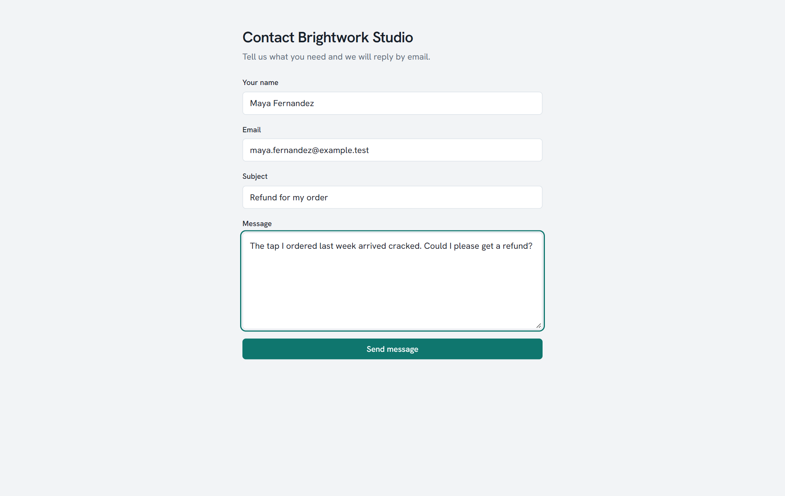

- **Web form.** Every workspace has a public form at `/form/<workspace-slug>` that anyone can use without an account. It is rate limited.
- **Email.** Each workspace has its own inbound address. Replies to your emails thread onto the right ticket by their headers and by a ticket address of the form `support+<token>.<number>@`.
- **In the local demo** there is no real mail server, so open **Channels** and use **Send simulated email**. It goes through exactly the same code as a real inbound email. Everything you send out appears in Mailpit at http://localhost:8025.

## People and the audit log

**People** lists teammates, lets you invite new ones by email (the link is single-use and expires in 7 days), change roles and deactivate accounts. The **Audit log** records who or what did what and when: signing in, changing tickets, changing rules and settings, retention runs. Entries made by an automation are labelled as a rule.

## Privacy and data retention

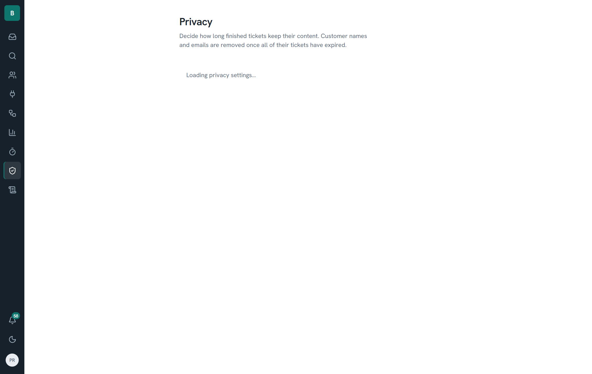

Choose how long finished tickets keep their content. After that period, resolved and closed tickets lose their message text and subject, related notifications are deleted, and customers whose tickets have all expired lose their name and email. Numbers, dates, priorities and service-level results stay so your reports remain accurate. Erasing on demand needs a confirmation and cannot be undone. See [Security and privacy](SECURITY.md) for the limits.

## Keyboard shortcuts

In the inbox (when you are not typing in a field), press `?` for the full list.

| Key | Does |
| --- | --- |
| `j` / `k` | Next / previous ticket |
| `Enter` | Open the ticket |
| `x` | Select or deselect the ticket |
| `e` | Mark as resolved |
| `a` | Assign to me |
| `r` | Reply to the open ticket |
| `c` | Create a new ticket |
| `f` | Filter by priority |
| `Ctrl+Enter` | Send the reply you are writing |

## Dark theme

Use the moon icon in the sidebar to switch themes. The choice is remembered.

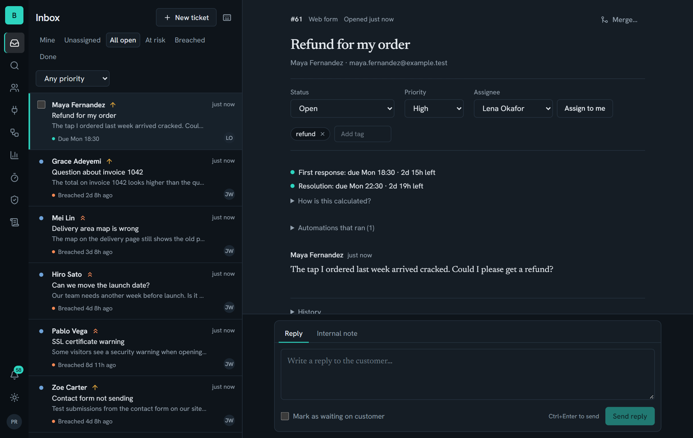
